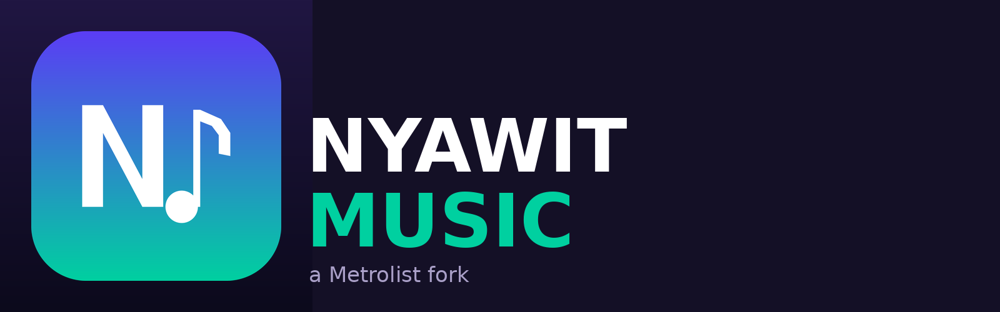

  

# Nyawit Music

**A Material Design YouTube Music client for Android, iOS and desktop — rebranded fork of [Metrolist](https://github.com/MetrolistGroup/Metrolist).**

Nyawit Music is a branding fork of the upstream Metrolist project. All upstream
capabilities — including online streaming, YouTube Music account support, the
InnerTube/extractor layer, network dependencies and in-app updates — remain
fully intact and are not modified by this fork.

> [!WARNING]
> Using Nyawit Music to access YouTube Music may violate YouTube's Terms of Service.
> Use it at your own risk. YouTube Music is region-restricted; a VPN or proxy in a
> supported region may be required.

## Features

- YouTube Music playback with or without signing in
- Android 7+, iOS 15+, Windows 10+, macOS 15+ and Linux support
- Material 3 Expressive design
- Discord Rich Presence and scrobbling through Last.fm and ListenBrainz
- No ads
- Listen Together for shared playback online
- Casting to Google Cast, F-Cast and SONOS devices, and over DLNA (Android and desktop)
- Backup and playlist imports from 30+ clients and 6 services
- Music recognition through Shazam
- Lyrics with translation and romanization
- Translations in over 15 languages
- Video playback (Android and desktop)
- Content filters for AI-generated content, explicit-only playback and SFW-only playback
- Canvas from Apple Music, Spotify and YouTube Music
- Player, thumbnail, miniplayer and background styles
- Custom fonts and app icons
- In-app and GitHub-based updates

## Downloads

Releases are published on the [Nyawit Music releases page](https://github.com/nyawit-dev/Metrolist/releases).
Android builds are named `NyawitMusic-<variant>.apk`. Installation guides for
[Android](docs/install/android.md), [iOS](docs/install/ios.md),
[Windows](docs/install/windows.md), [macOS](docs/install/macos.md) and
[Linux](docs/install/linux.md) are kept in sync with upstream.

## Building

Builds are produced by GitHub Actions. The Gradle project name is
`Nyawit Music`, the Android application id is `dev.nyawit.music`, and the
namespace stays `com.metrolist.android` so upstream synchronisation remains
straightforward.

## Attribution & license

This project is a fork of [MetrolistGroup/Metrolist](https://github.com/MetrolistGroup/Metrolist)
and is distributed under the **GNU General Public License v3.0**. See
[ATTRIBUTION.md](ATTRIBUTION.md) and [LICENSE](LICENSE). Visual assets in this
fork were generated originally with Pillow; no third-party artwork is included.
